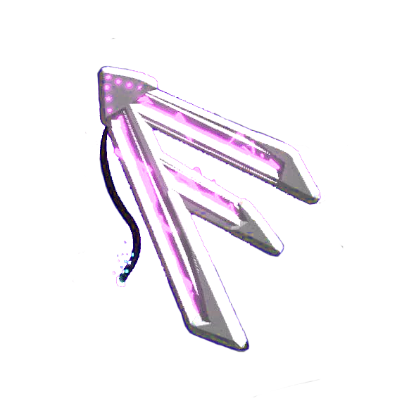

# Frey Labs

11/03/2026: Team starting now with only me, but with candidates for becoming members in the near future.

1. We are a Team:
  - We are not an organization, not a company, just a team. We are not and will never be affiliated with any organization, company, or political party. We may help organizations and companies, but Frey Labs is independent and autonomous as a team.

2. Legal:
  - We will always operate under Brazil laws and human rights, and we do not intend to attack any organization, company, or political party. We just do our thing, peacefully.

3. Members:
  - I, Frey da Costa, am the creator of the team, but we will discuss everything together. Each member will operate in their areas as we work together. Anything a member does outside of the team and its rules is not considered an action of Frey Labs

4. Recruiting:
  - Frey Labs won't be a giant team, to reduce risk of eventual breakage of the rules stated here.
  
5. Licensing
  - All Frey Labs projects will use the GPL-3.0 License (GNU General Public License v3.0), hosted at https://www.gnu.org/licenses/gpl-3.0.en.html and will be free and open-source for anyone.

6. Mission:
  - We want to provide support for all areas of knowledge, and build our own technology.
